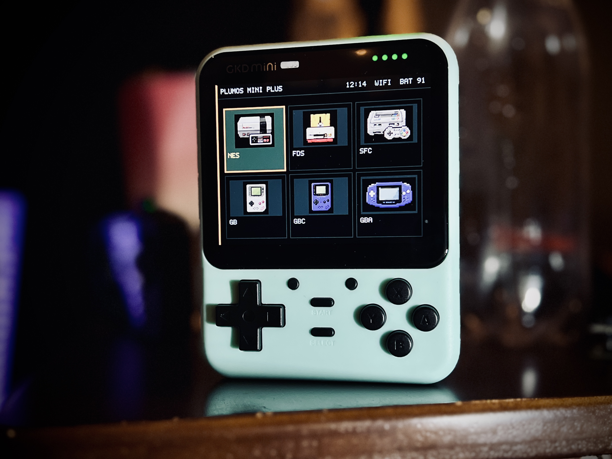
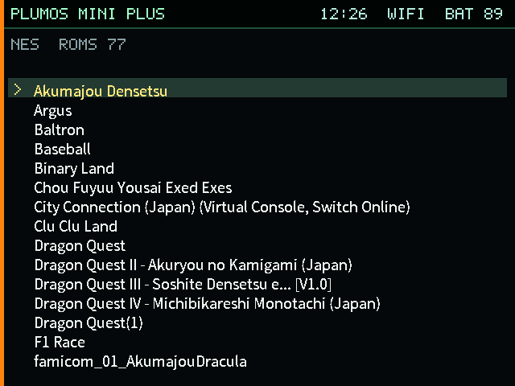
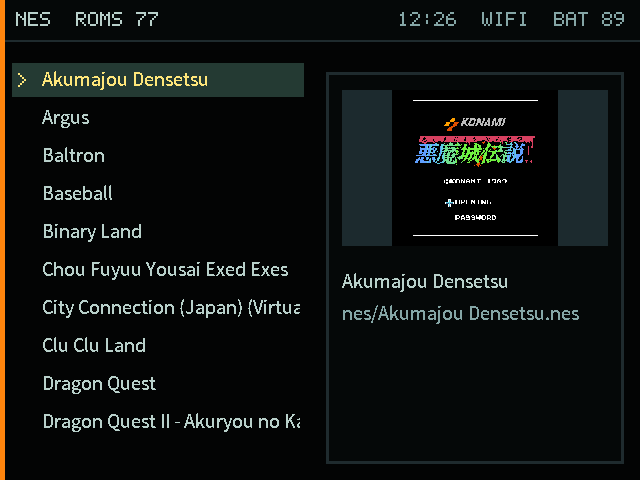
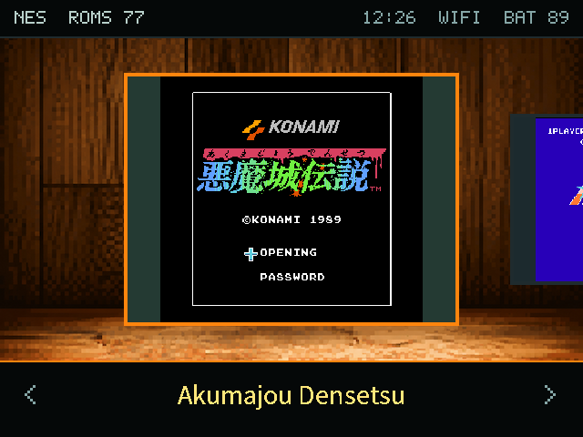

# plumOS mini PLUS

日本語 | [English](README.md)

正式バージョン：**0.1.0**。[日英リリースノート](docs/releases/0.1.0.md)。
配布名はBubble形式の`plumos-mini-plus-v0.1.0-sd-image.img`／`.7z`です。最終imageの受入・公開は未完了です。

plumOS-Bubbleをベースにした、**GKD mini PLUS（RK3566 / ARM64、640×480）**向けplumOSです。本体には4個のFNキーがあり、アナログスティックはありません。

<p align="center"></p>

## 3種類の表示

| テキスト | グラフィック | ギャラリー |
| --- | --- | --- |
| [](docs/images/frontend-text.png) | [](docs/images/frontend-graphics-list.png) | [](docs/images/frontend-gallery.png) |

スクリーンショットはmini PLUS実機で撮影しました。提供された本体写真はEXIF・XMP等のカメラ情報を除去し、主画像のデコード後の画素は保持しています。画面内のゲーム画像は利用例で、OSへの同梱物ではありません。

`START → UI設定（UI Settings）→ UI Mode → Text / Graphic`で切り替えます。ゲーム一覧で`X`を押すとギャラリー、もう一度`X`で一覧へ戻ります。[基本操作](docs/user/operation.ja.md)も参照してください。

## 最初にすること

1. [SD1へ書き込み、初回起動](docs/user/install.ja.md)。
2. [Wi-Fi接続と転送サービスの有効化](docs/user/network.ja.md)。SSHとSFTPは別々にONにします。
3. [ROMとBIOSを追加](docs/user/storage.ja.md)し、ゲームを選んで`A`で起動。
4. [エミュレーターの終了・メニュー・ホットキー早見表](docs/user/emulators.ja.md)を確認。

| 覚えておく操作 | 動作 |
| --- | --- |
| `A` / `B` | FEで決定・起動 / 戻る |
| `START` | FEのメインメニュー |
| **STARTの右上の丸いキー** | エミュメニュー（内部名F1）。FEではスクリーンショット |
| RetroArch中に`SELECT` + `START` | FEへ戻る。終了確認が出たら同じ操作をもう一度 |
| `SELECT`を押しながら音量− / ＋ | 画面を暗く / 明るくする |
| 電源ボタン短押し | Sleep・Reboot・Shutdownを選ぶ電源メニュー |

PicoArch・単体エミュレーターは各メニューから終了します。PortsやPyxelはゲームごとの終了方法を使います。RetroArch用のショートカットが全アプリ共通という意味ではありません。

## 主な機能

- テキスト・グラフィック・ギャラリー表示、画像スクレイピング、Game Gear専用FE（GGFE）。
- RetroArch、PicoArch、単体エミュレーター、追跡対象114個のlibretro core。
- PortMaster、Pyxel、File Manager、Music Player、SD2修復。
- Wi-Fi、SSH・SFTP・FTP・Samba。SD2のROM／BIOSを優先し、不在時はSD1へ切替。
- 音量・輝度キー、スピーカー／イヤホン切替、安全な電源操作、USB充電中／未接続のSleep。
- 署名付きRuntime更新と、対応する起動処理でのSystem A/B試行・ロールバック。

ROM、利用者BIOS、商用ゲームは同梱しません。この移植ではUSBは充電用で、ADBとHDMI出力は未対応です。

## 現在の状態

**公開前の開発版**です。新SDの起動、SD1／SD2のプレイ、ハードウェア操作はユーザー確認済みで、Runtime／Systemの復旧も機械・実機試験の記録があります。196起動経路のうち170経路に機械的な起動証拠があり、残る26経路は未検証理由を明示しています。全ゲームの互換性を保証するものではありません。

現在の作業SDは後続のboot／app更新を含み、以前の開発用`.img`にはその全てが入っていません。最終イメージの再生成・exact-image受入・公開は別工程です。[最新の作業記録](docs/validation/2026-10-31-mini-plus-pre-release-work.md)、[既知の検証制限](docs/validation/2026-10-31-mini-plus-runtime-limitations.ja.md)、[TODO](TODO.md)を参照してください。

## ドキュメント

- [取扱説明書](docs/user/README.ja.md)：導入、操作、SD、エミュレーター、アプリ、セーブ、画像取得、通信、更新、問題対処。
- [開発者ガイド](docs/developer/README.ja.md)：構成、ビルド、Runtime、描画、ハードウェア、通信、更新、検証。
- [ドキュメント索引](docs/README.ja.md) / [English documentation](docs/README.md)。

## ビルド

記載のツールチェーンと承認済みvendor入力を用意して実行します。

```sh
./scripts/build-mini-plus-full-image.sh
```

既定のraw出力は`output/image/mini-plus-frontend-probe/plumOS-mini-PLUS-0.1.0-full-stack-validation.img`です。seedは約2.90 GBで、初回に管理領域を8 GiBへ拡張し、残りに利用者領域を作ります。16 GB以上のSDを使用してください。前提条件・version指定・検証は[ビルドガイド](docs/developer/build.ja.md)へ。圧縮は別のリリース工程です。

## ライセンス

plumOS独自部分は[MIT License](LICENSE)です。vendorのboot／runtime資産と第三者ソフトウェアには各権利者の条件が適用されます。[第三者表記](THIRD_PARTY_NOTICES.md)を確認してください。
